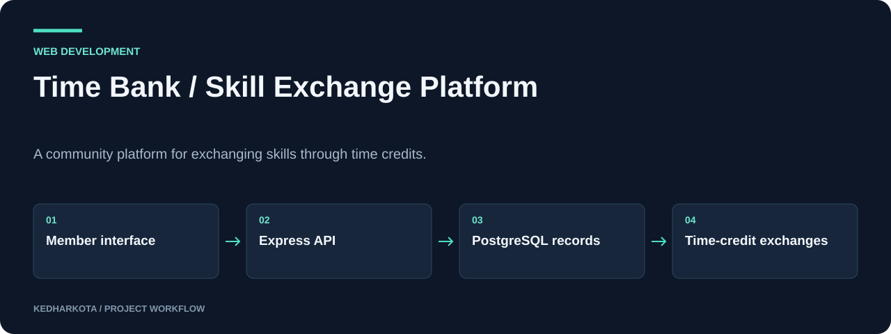
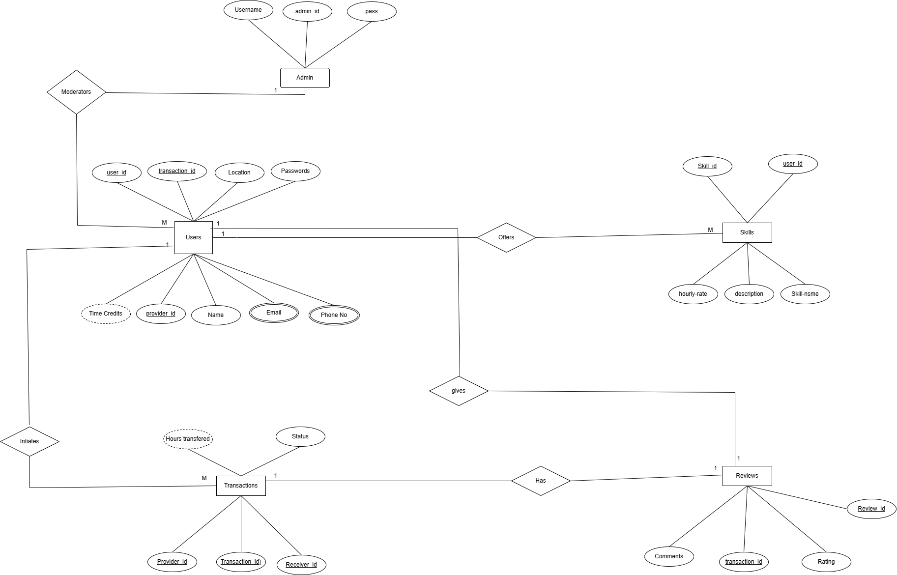

# Time Bank · Skill Exchange Platform

A community platform for exchanging skills through time credits.

**JavaScript · Node.js · Express · PostgreSQL · HTML/CSS**

[](https://github.com/kedharkota/-Time-skill-exchange-Platfrom-/actions/workflows/docs.yml)

[Overview](#overview) · [Getting started](#getting-started) · [Repository guide](#repository-guide) · [Reproducibility](docs/REPRODUCIBILITY.md)

<p align="center">
  
</p>

[Open full-size visual](docs/assets/preview.png)

*Actual public landing page. Database-backed interactions were not exercised.*

## Project at a glance

| Detail | Project information |
| --- | --- |
| **Focus** | Community skill exchange with time credits |
| **Start here** | [index.html](index.html) |
| **Run mode** | Static frontend preview plus Node.js/PostgreSQL backend |
| **Explore** | Landing page, member interfaces, API routes, and database design |

## Overview

A web application prototype where members offer skills, request help, and track exchanges using time credits. The source includes authentication, skill listings, transaction and review endpoints, community pages, and a relational database schema.

## What this project includes

- User and administrator registration/login with bcrypt and JWT handling.
- Skill creation, updates, deletion, and matching endpoints.
- Transactions, reviews, notifications, and community statistics.
- Member dashboard, profile, skill browsing, and community pages.

## Workflow

<p align="center">
  
</p>

[Open full-size visual](docs/assets/overview.svg)

*Explanatory diagram. Detailed implementation and availability notes follow below.*

## Getting started

For a visual preview, serve the repository directory:

```bash
python -m http.server 5500
```

Open http://localhost:5500. This previews the interface only.

For the backend, install Node.js and PostgreSQL. The original repo has no package manifest. In a local checkout, initialize one and install the modules required by `server.js`:

```bash
npm init -y
npm install express pg bcrypt uuid@9 jsonwebtoken cors dotenv
```

Use a UUID version supporting the existing CommonJS `require` syntax. Create a PostgreSQL database, import `dbms.sql`, and configure `.env` with `DB_HOST`, `DB_USER`, `DB_PASSWORD`, `DB_NAME`, `DB_PORT`, `JWT_SECRET`, and optional `PORT`. Then run `node server.js`.

### Required inputs and current constraints

The backend defaults to port 3000 and allows the frontend origin `http://localhost:5500`. It expects HTML under `public/`, while the committed HTML is at the root: create/populate a local `public/` directory or adjust the static routes before testing server-rendered pages. Review the database schema against all API queries; full integration is not verified.

## Repository guide

| File | Purpose |
| --- | --- |
| [index.html](index.html) | Public landing page. |
| [login.html](login.html) | Authentication interface. |
| [dashboard.html](dashboard.html) | Member dashboard. |
| [skills.html](skills.html) | Skill discovery interface. |
| [profile.html](profile.html) | Member profile interface. |
| [community.html](community.html) | Community interface. |
| [server.js](server.js) | Express API and PostgreSQL integration. |
| [dbms.sql](dbms.sql) | Database schema. |
| [styles.css](styles.css) | Shared page styling. |
| [A5.drawio.png](A5.drawio.png) | Original database design diagram. |

## Results and project status

The screenshot shows the actual landing page, without a running database. API routes and UI files are present, but a complete authenticated exchange flow was not executed. Configure a private JWT secret before using authentication.

<details>
<summary>Original database design</summary>

<p align="center">
  
</p>

[Open full-size visual](docs/assets/database-design.png)

</details>

## Next steps

- Commit and lock the dependency manifest after a verified install.
- Resolve the root/public directory mismatch and test each API operation against the SQL schema.

## Documentation maintenance

<details>
<summary>Run documentation checks and maintain visuals</summary>

Local documentation links and image headers are checked on pull requests and relevant pushes by the [documentation workflow](.github/workflows/docs.yml). Run the same check locally:

```bash
python tools/check_docs.py
```

See the [reproducibility guide](docs/REPRODUCIBILITY.md) for evidence, missing artifacts, and visual-source notes. The check validates documentation files; it does not train models or certify application behavior.

</details>

## Explore related projects

- [Kota Kedharnadh / Developer Portfolio](https://github.com/kedharkota/My-Portfolio)

---

[More projects by kedharkota](https://github.com/kedharkota?tab=repositories)
